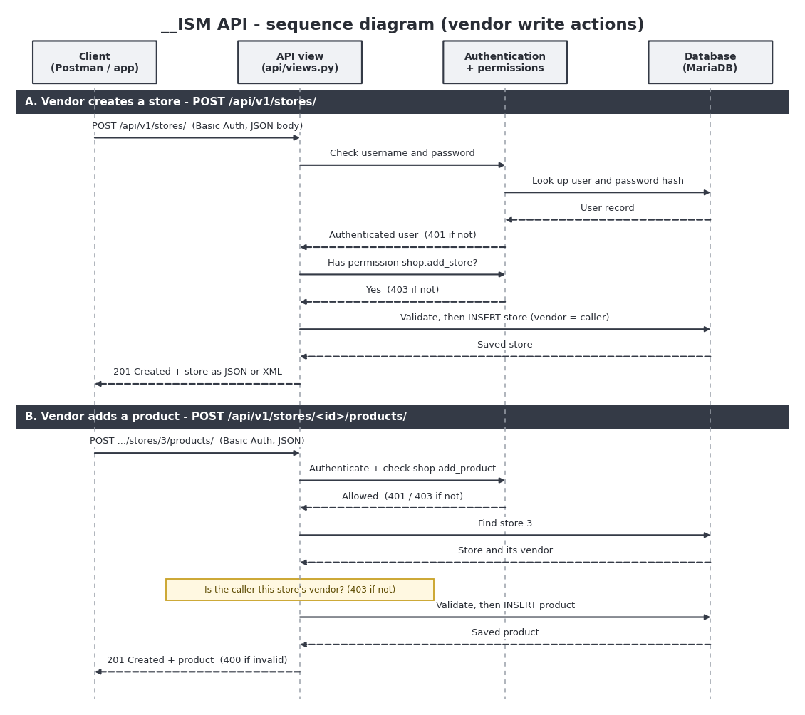
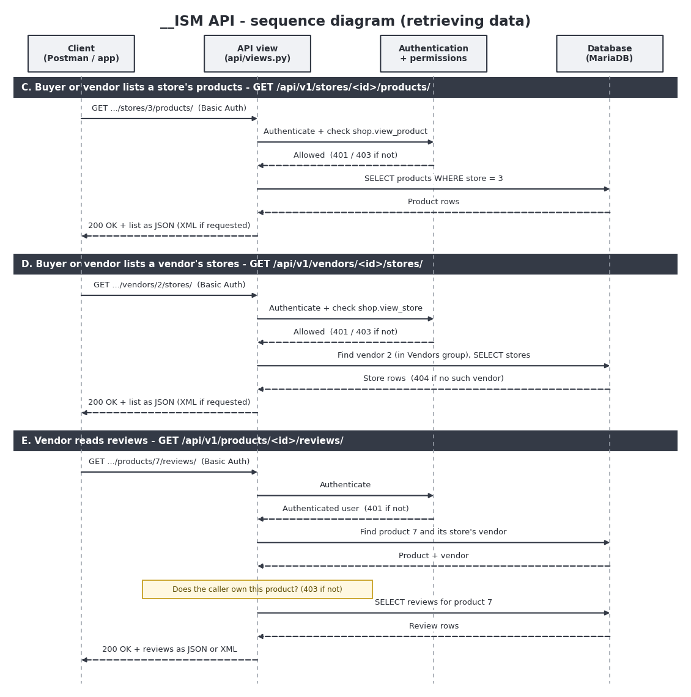
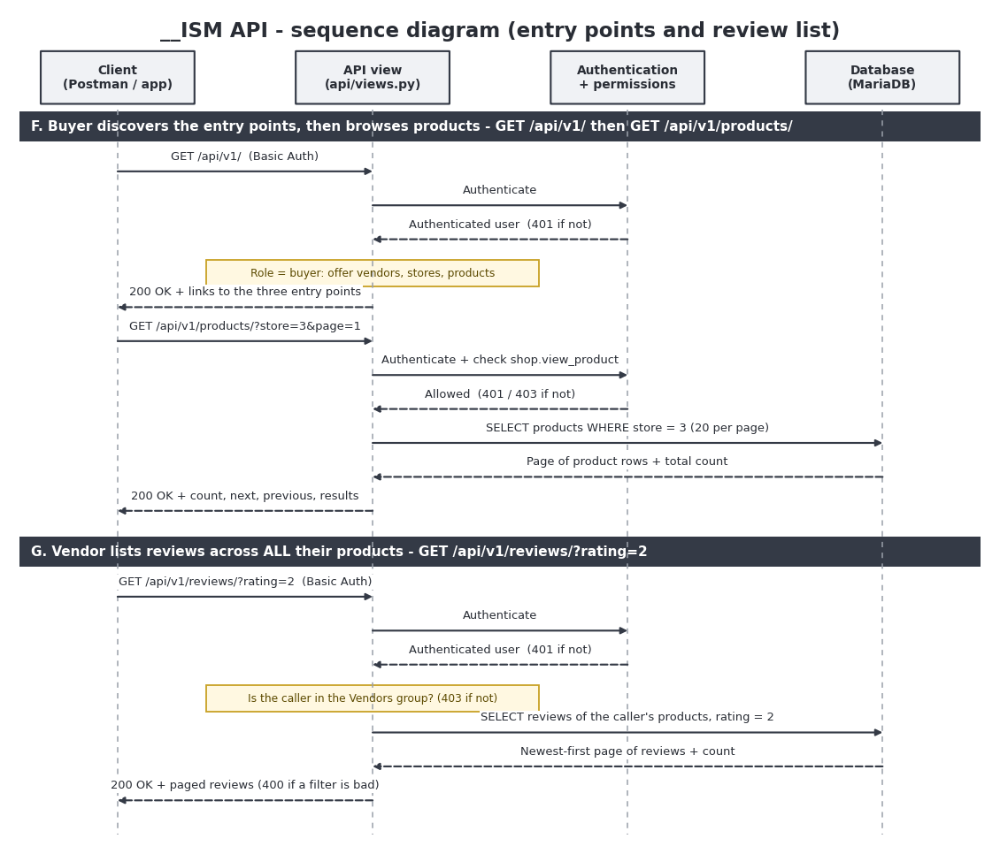

# `__ISM` – API Planning (Part 2)

## 1. Purpose and scope

The website already lets vendors and buyers use `__ISM` through a browser.
The API lets other programs do some of the same things over HTTP, using JSON
or XML instead of HTML pages.

**Required by the task**

1. Vendors can **create stores** and **add products** to their stores, and can
   **retrieve reviews**. These actions require authentication.
2. Buyers and vendors can **retrieve the stores listed under each vendor** and
   **the products of each store**.
3. **Entry points per role.** A vendor starts from *stores* and *products*. A
   buyer starts from *vendors*, *stores* and *products*.
4. **A review list for the vendor.** A vendor must be able to see reviews
   across *all* their products in one request, with filters, instead of
   opening every product to look for them.

Everything else (carts, checkout, registration) stays on the website.

---

## 2. Resources and how they are represented

Each model that appears in the API has a serializer that decides which fields
are exposed and which the client may set.

| Resource  | Fields exposed                                                                    | Set by the client                   | Set by the server           |
|-----------|-----------------------------------------------------------------------------------|-------------------------------------|-----------------------------|
| Vendor    | id, username                                                                      | nothing (read-only)                 | everything                  |
| Store     | id, name, vendor, vendor_name                                                     | name                                | vendor (the logged-in user) |
| Product   | id, store, store_name, name, description, price, stock                            | name, description, price, stock     | store (taken from the URL)  |
| Review    | id, product, product_name, author, rating, title, body, created_at, is_verified   | nothing (read-only)                 | everything                  |

- **JSON is the default representation.** A client can ask for **XML** by
  sending the header `Accept: application/xml` (or adding `?format=xml`).
- Prices are sent as **strings** (`"9.99"`) so no precision is lost.
- A review's author is shown as a **username**, not an internal id.
- A vendor is shown as an **id and username only**. No email address or
  password hash is ever exposed.

**JSON example (a product)**

```json
{
  "id": 5,
  "store": 1,
  "store_name": "Store One",
  "name": "Widget",
  "description": "A widget",
  "price": "9.99",
  "stock": 5
}
```

**Lists are paged.** A list comes back inside a wrapper, 20 items at a time:

```json
{
  "count": 57,
  "next": "http://127.0.0.1:8000/api/v1/products/?page=2",
  "previous": null,
  "results": [ ... 20 products ... ]
}
```

**XML example (a list of products)**

```xml
<?xml version="1.0" encoding="utf-8"?>
<root>
  <count>1</count>
  <next></next>
  <previous></previous>
  <results>
    <list-item>
      <id>5</id>
      <store>1</store>
      <store_name>Store One</store_name>
      <name>Widget</name>
      <description>A widget</description>
      <price>9.99</price>
      <stock>5</stock>
    </list-item>
  </results>
</root>
```

---

## 3. Entry points

An **entry point** is where a client starts. `GET /api/v1/` tells a logged-in
client which entry points its role has, as full links it can follow, so the
client does not need to know the URL layout in advance.

| Role    | Entry points                                                                |
|---------|-----------------------------------------------------------------------------|
| Buyer   | `vendors`, `stores`, `products` (everything is visible)                     |
| Vendor  | `stores` and `products` (their own), and `reviews` (of their own products)  |

```json
{
  "role": "vendor",
  "entry_points": {
    "stores": "http://127.0.0.1:8000/api/v1/stores/",
    "products": "http://127.0.0.1:8000/api/v1/products/",
    "reviews": "http://127.0.0.1:8000/api/v1/reviews/"
  }
}
```

---

## 4. Endpoints

All endpoints live under `/api/v1/`. The `v1` leaves room to change the API
later without breaking existing users.

### Entry points

| Method  | Path                  | Who                                         | Purpose                                                                                     |
|---------|-----------------------|---------------------------------------------|---------------------------------------------------------------------------------------------|
| GET     | `/api/v1/`            | Anyone logged in                            | The entry points for the caller's role                                                      |
| GET     | `/api/v1/vendors/`    | Buyers, vendors                             | All vendors                                                                                 |
| GET     | `/api/v1/stores/`     | Buyers (all stores), vendors (their own)    | List stores. Filter: `?vendor=<id>` (buyers)                                                |
| POST    | `/api/v1/stores/`     | Vendors                                     | Create a store                                                                              |
| GET     | `/api/v1/products/`   | Buyers (all products), vendors (their own)  | List products. Filters: `?store=<id>`, `?search=<text>`                                     |
| GET     | `/api/v1/reviews/`    | Vendors                                     | Reviews of all their products, newest first. Filters: `?store=<id>`, `?product=<id>`, `?rating=<n>`, `?verified=true\|false` |

### Nested resources

| Method  | Path                              | Who                   | Purpose                       |
|---------|-----------------------------------|-----------------------|-------------------------------|
| GET     | `/api/v1/vendors/<id>/stores/`    | Buyers, vendors       | Stores listed under a vendor  |
| GET     | `/api/v1/stores/<id>/products/`   | Buyers, vendors       | Products of a store           |
| POST    | `/api/v1/stores/<id>/products/`   | The store's vendor    | Add a product to the store    |
| GET     | `/api/v1/products/<id>/reviews/`  | The product's vendor  | Reviews of one product        |

---

## 5. Authentication and authorisation

Every endpoint applies three layers, in this order:

1. **Authentication: HTTP Basic.** Each request carries a username and password
   in the `Authorization` header. This suits a stateless API, because the
   server keeps no session between requests. It is only safe over **HTTPS**,
   because Basic credentials are encoded, not encrypted. The development server
   uses plain HTTP, so a real deployment must add HTTPS.
2. **Permission.** The user's group must allow the action (`shop.add_store`,
   `shop.add_product`, `shop.view_product`, `shop.view_store`). These are the
   same group permissions the website uses.
3. **Ownership and scope.** Writing to a store requires owning it. A vendor's
   lists (stores, products, reviews) are filtered to their own data, so they
   cannot see another vendor's products or reviews even by guessing ids.

---

## 6. Status codes

| Code                    | Meaning in this API                                                               |
|-------------------------|-----------------------------------------------------------------------------------|
| 200 OK                  | Data retrieved                                                                    |
| 201 Created             | Store or product created                                                          |
| 400 Bad Request         | Invalid data, or an unusable filter (`?rating=abc`)                               |
| 401 Unauthorized        | Missing or wrong username and password                                            |
| 403 Forbidden           | Logged in, but the group or ownership check failed                                |
| 404 Not Found           | The store, product or vendor does not exist, or the page number is past the end   |
| 405 Method Not Allowed  | The path does not support that HTTP method                                        |
| 406 Not Acceptable      | The client asked for a format that is not offered                                 |

---

## 7. Planning for failure

| What could go wrong                                                 | How the API responds                                                                                |
|---------------------------------------------------------------------|-----------------------------------------------------------------------------------------------------|
| No login details or a wrong password                                | 401, and nothing is read or changed                                                                 |
| A buyer tries to create a store or add a product                    | 403                                                                                                 |
| A buyer asks for the review list                                    | 403 (vendors only)                                                                                  |
| A vendor tries to add a product to another vendor's store           | 403, nothing is created                                                                             |
| A vendor asks for another vendor's reviews                          | 403 on the per-product route; the review list simply never includes them                            |
| The client sends a different `vendor` or `store` value in the body  | Ignored, because those fields are read-only                                                         |
| Invalid price (negative, text, too many decimals) or negative stock | 400 with a message per field                                                                        |
| A filter such as `?rating=abc` or `?verified=maybe`                 | 400 naming the parameter, rather than silently ignoring it                                          |
| A store, product or vendor id that does not exist                   | 404                                                                                                 |
| An id that belongs to a user who is not a vendor                    | 404                                                                                                 |
| A huge list                                                         | Paged, 20 at a time (up to 100 with `?page_size=`), so one request never returns thousands of rows  |
| A page number past the end                                          | 404                                                                                                 |
| The client asks for a format that is not offered                    | 406 Not Acceptable                                                                                  |
| The database is unavailable                                         | 500, and nothing is saved                                                                           |

---

## 8. Sequence diagrams

The diagrams show how a request moves between the client, the API view, the
authentication and permission checks, and the database.

- `sequence_diagram_vendor_actions.png`: creating a store (A) and adding a
  product (B).
- `sequence_diagram_retrieving_data.png`: listing a store's products (C),
  listing a vendor's stores (D) and a vendor reading one product's reviews (E).
- `sequence_diagram_entry_points.png`: a buyer discovering the entry points and
  browsing (F), and a vendor listing reviews across all their products (G).







---

## 9. Third-party integration: Reddit feed

The site also **consumes** an API. A helper function in
`shop/functions/reddit.py` uses the Python `requests` module to fetch posts
from a subreddit's public JSON feed, and the `/reddit/` page shows each post's
title, author and a link.

**Flow:** browser → `reddit_feed` view → helper (`requests.get` with a
`User-Agent` header) → Reddit → helper parses the JSON into a list → view passes
the list to the template → page.

**Failure planning**

| What could go wrong                                       | Response                                                                      |
|-----------------------------------------------------------|-------------------------------------------------------------------------------|
| Network down or Reddit too slow                           | The request times out after 10 seconds and the page shows a friendly message  |
| Reddit refuses the request (403) or rate-limits it (429)  | The page shows a message naming the problem                                   |
| Reddit sends data in an unexpected shape                  | The page shows a message instead of crashing                                  |
| A post has a link that is not `http` or `https`           | The link is dropped, so unsafe links are never rendered                       |
| The subreddit name contains unexpected characters         | Rejected before any request is made                                           |

**Known limitation:** Reddit has restricted unauthenticated access to its public
feeds, so the feed may be refused. The page is built to show the reason when
that happens.

---

## 10. Testing plan

- **Automated:** `python manage.py test api --noinput` runs tests for
  authentication, entry points, permissions, ownership, filters, paging,
  validation, and the JSON and XML representations.
- **Manual (Postman):** each endpoint is called with Basic Auth for a vendor,
  another vendor and a buyer, checking the status code and body each time.
