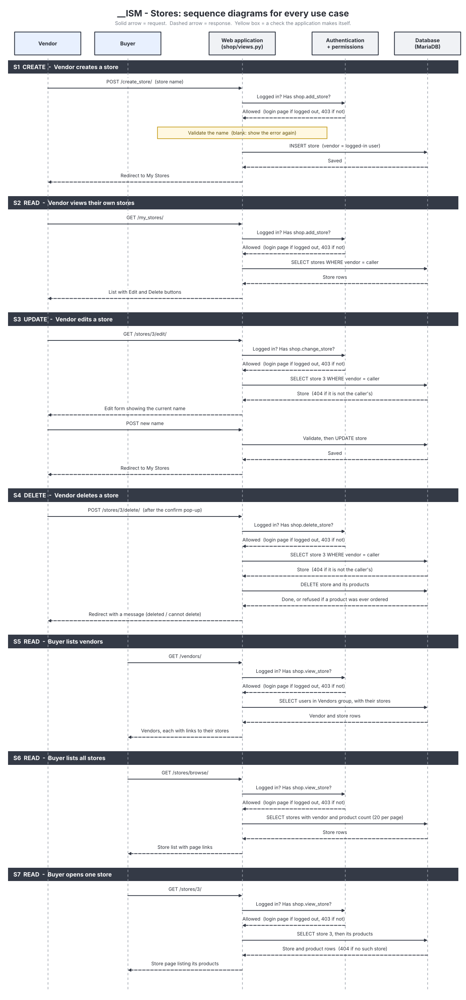
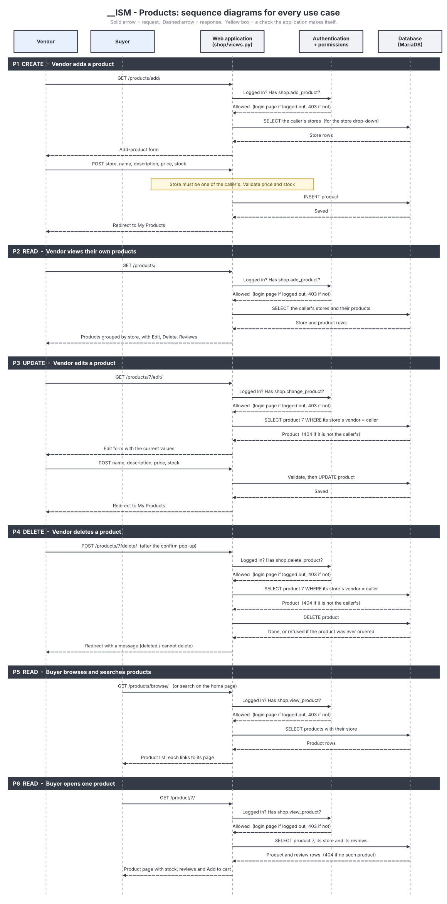
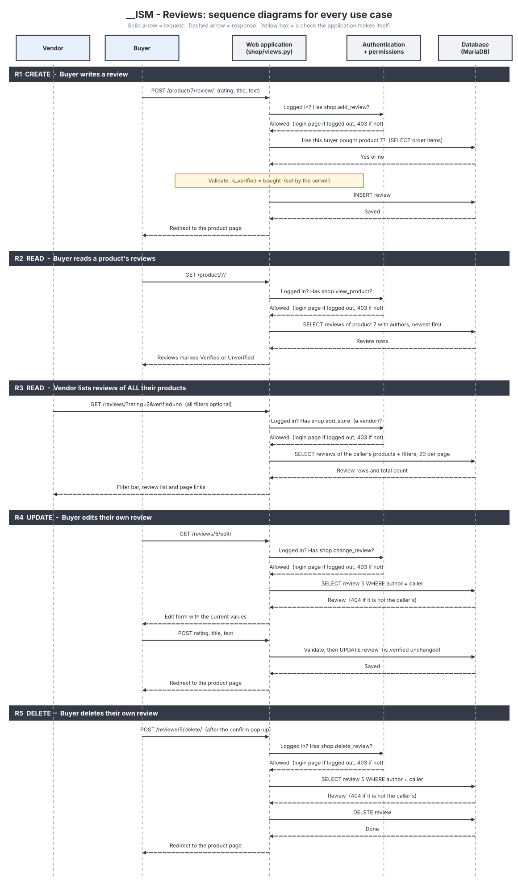

# `__ISM` – Use cases and sequence diagrams

This document lists every use case for the three main entities (**Stores**,
**Products** and **Reviews**), shows who can do each one, and points to the
sequence diagram that shows how it works.

## Actors

| Actor | Who they are | Group |
|---|---|---|
| **Vendor** | Runs stores and sells products | Vendors |
| **Buyer** | Browses, buys and reviews | Buyers |

Each diagram has the actors, the web application, the authentication and
permission checks, and the database as lifelines. Every request passes the
same three checks before the database is touched:

1. **Logged in?** If not, the visitor is sent to the login page.
2. **Does the group have the permission?** If not, the answer is 403.
3. **Is it the caller's own data?** If not, the answer is 404.

## CRUD matrix

C = create, R = read, U = update, D = delete.

### Stores

| Diagram | CRUD | Use case | Actor | Web page | API | Permission |
|---|---|---|---|---|---|---|
| S1 | C | Create a store | Vendor | `/create_store/` | `POST /api/v1/stores/` | `add_store` |
| S2 | R | View their own stores | Vendor | `/my_stores/` | `GET /api/v1/stores/` | `add_store` |
| S3 | U | Edit a store | Vendor | `/stores/<id>/edit/` | – | `change_store` |
| S4 | D | Delete a store | Vendor | `/stores/<id>/delete/` | – | `delete_store` |
| S5 | R | List vendors | Buyer, Vendor | `/vendors/` | `GET /api/v1/vendors/` | `view_store` |
| S6 | R | List all stores | Buyer, Vendor | `/stores/browse/` | `GET /api/v1/stores/`, `GET /api/v1/vendors/<id>/stores/` | `view_store` |
| S7 | R | Open one store | Buyer, Vendor | `/stores/<id>/` | `GET /api/v1/stores/<id>/products/` | `view_store` |

### Products

| Diagram | CRUD | Use case | Actor | Web page | API | Permission |
|---|---|---|---|---|---|---|
| P1 | C | Add a product to their store | Vendor | `/products/add/` | `POST /api/v1/stores/<id>/products/` | `add_product` |
| P2 | R | View their own products | Vendor | `/products/` | `GET /api/v1/products/` | `add_product` |
| P3 | U | Edit a product | Vendor | `/products/<id>/edit/` | – | `change_product` |
| P4 | D | Delete a product | Vendor | `/products/<id>/delete/` | – | `delete_product` |
| P5 | R | Browse and search products | Buyer, Vendor | `/products/browse/`, home page search | `GET /api/v1/products/` | `view_product` |
| P6 | R | Open one product | Buyer, Vendor | `/product/<id>/` | `GET /api/v1/stores/<id>/products/` | `view_product` |

### Reviews

| Diagram | CRUD | Use case | Actor | Web page | API | Permission |
|---|---|---|---|---|---|---|
| R1 | C | Write a review | Buyer | `/product/<id>/review/` | – | `add_review` |
| R2 | R | Read a product's reviews | Buyer, Vendor | `/product/<id>/` | – | `view_product` |
| R3 | R | List reviews of **all** their products, with filters | Vendor | `/reviews/` | `GET /api/v1/reviews/` | `add_store` (a vendor) |
| R4 | U | Edit their own review | Buyer | `/reviews/<id>/edit/` | – | `change_review` |
| R5 | D | Delete their own review | Buyer | `/reviews/<id>/delete/` | – | `delete_review` |

## What each actor may NOT do

| Actor | Refused | Response |
|---|---|---|
| Buyer | Create, edit or delete a store or product | 403 |
| Buyer | Open the vendor review list (`/reviews/`) | 403 |
| Buyer | Edit or delete **another** buyer's review | 404 |
| Vendor | Edit or delete **another** vendor's store or product | 404 |
| Vendor | Write, edit or delete a review | 403 |
| Anyone not logged in | Any page except the home page, login, registration and password reset | Redirected to login |

## Design notes

- **Reviews are verified by the server.** `is_verified` is set when the review
  is written (R1), by checking whether the buyer has an order containing the
  product. Editing a review (R4) never changes it.
- **A vendor's lists are scoped before they are filtered.** The review list
  (R3) first selects only reviews of the vendor's own products, and only then
  applies the filters (store, product, rating, verified). A filter can narrow
  the list but can never reveal another vendor's reviews.
- **Entry points.** Buyers start from **Vendors**, **Stores** and **Browse
  Products** (S5, S6, P5). Vendors start from **My Stores**, **My Products**
  and **My Reviews** (S2, P2, R3).
- **Deleting protects sales history.** A product that has been ordered cannot
  be deleted, because order items point to it. The vendor sees a message
  instead of an error (S4, P4).
- **The API covers the use cases the task asks for** (create a store, add a
  product, read stores, products and reviews). Update and delete are
  website-only.
- The API sequence diagrams are in `5. API Planning.md`.
